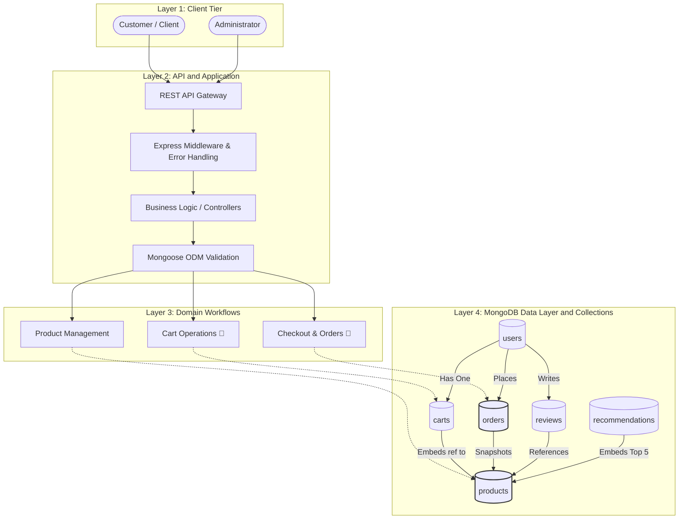

<div align="center">


**Intelligent NoSQL E-Commerce Platform**

UrbanKart is a comprehensive academic backend engineered to demonstrate advanced MongoDB/NoSQL data modeling, rigorous validation layers, deterministic seed workflows, and intelligent materialized recommendation views.


</div>

---

## 📖 2. Overview
UrbanKart is a modern, high-performance online storefront designed to showcase how next-generation databases solve the biggest headaches in the e-commerce industry.

Instead of using older database systems that force data into rigid tables, UrbanKart is powered by **MongoDB**—a flexible system that stores data much like real-world documents. This allows the platform to effortlessly handle vastly different types of products in the same catalog, manage thousands of active shopping carts without crashing, lock in past order receipts permanently, and generate smart 'products you might like' recommendations without slowing down the website.

## ❓ 3. Problem Statement
Building a modern online store is complicated. Older database systems (like SQL) force data into strict, rigid tables that don't easily handle the messy reality of e-commerce. UrbanKart uses NoSQL to solve four major real-world business problems:

*   **The "Every Product is Different" Problem (Product Variety):** A laptop has "RAM" and a "Processor", but a t-shirt has a "Size" and "Color". Trying to cram completely different products into the exact same rigid database table creates messy, slow systems. UrbanKart uses flexible documents to let every product have its own unique traits effortlessly.
*   **The "Changing Price" Problem (Receipt Accuracy):** If a customer buys a shirt for $20 today, and the store raises the price to $25 tomorrow, the customer's past receipt must still permanently say $20. UrbanKart guarantees this financial accuracy by taking a permanent "snapshot" of the item at the exact moment of purchase.
*   **The "Shopping Cart" Problem (Website Speed):** Customers add, remove, and update items in their carts constantly, often without ever checking out. This creates massive stress on a database. UrbanKart stores cart data in a way that handles thousands of rapid clicks without slowing down the rest of the website.
*   **The "Smart Recommendations" Problem (Analytics):** Suggesting "Products you might also like" requires heavy math that can make the whole website freeze if calculated on the fly. UrbanKart solves this by pre-calculating these recommendations behind the scenes and storing them for instant loading.

By leveraging MongoDB's flexible document model, UrbanKart handles these complex business requirements seamlessly without sacrificing speed or stability.

## 🎯 4. Project Objectives

| Business Goal | How UrbanKart Achieves This |
| :--- | :--- |
| **Flexible Product Catalog** | Storing products as flexible "documents" instead of rigid tables, allowing electronics and clothing to exist side-by-side easily. |
| **Lightning-Fast Carts** | Grouping cart items directly with the user's profile to make adding and removing items practically instant. |
| **Infinite Customization** | Using a smart design pattern so sellers can add any product feature (like 'Bluetooth' or 'Fabric type') without rewriting the website's code. |
| **Bulletproof Data Security** | Double-checking every piece of data (like making sure prices are never negative) at both the website level and the deep database level. |
| **Seamless App Integration** | Building a clean, standard communication system (API) so future mobile apps and web browsers can both talk to the store easily. |
| **Permanent Digital Receipts** | Taking a permanent snapshot of the exact name and price of an item at checkout so past receipts never change, even if the store updates its catalog. |
| **Instant Recommendations** | Calculating "Similar Products" overnight and saving the results, so the website loads instantly for shoppers the next day. |
| **Professional Engineering** | Following strict, industry-standard rules for writing code, ensuring the website is stable, secure, and easily maintainable by future developers. |

## 🏗️ 5. High-Level Architecture



## 🔄 6. End-to-End Data Flow

The flow of data through UrbanKart prioritizes separation of concerns and database safety.

**General HTTP Flow:**
`Client` → `Express API` → `Middleware` → `Mongoose Model` → `MongoDB Atlas` → `API Response`

### Product Retrieval Flow (✅ Implemented)
`Client` → `GET /api/products` → `Product.find({})` → `MongoDB products collection` → `JSON Array Response`

### Authentication Flow (Backend Implemented; Live Integration Depends on Database Configuration)
`Client` → `POST /api/auth/login` → `User Model` → `Verify bcrypt Hash` → `Generate JWT` → `Protected Route Access`

### Checkout Flow (Stage H Implemented and Locally Verified)
`Authenticated cart` → `POST /api/cart/checkout + Idempotency-Key` → `server-side cart fingerprint and unique user/key operation` → `transactional stock/order/cart update` → `authenticated order reconciliation`
Stage H now verifies the idempotent checkout and reconciliation contract against an isolated local replica set; see [the client Stage H notes](client/README.md#stage-h-idempotent-checkout-and-order-reconciliation).
The Stage F statement below is historical and is superseded by the Stage G and Stage H local replica-set verification records.

### Recommendation Flow (📅 Planned logic, Schema ✅ Implemented)
`Offline Job` → `Compute Similarity` → `Overwrite recommendations collection` → `Client queries O(1) Materialized View`

## 🧩 7. Core Collections and Operation Records

| Collection | Purpose | Schema Fields & Key Modeling Idea | Status |
| :--- | :--- | :--- | :--- |
| **products** | Core catalog | `attributes[{ key, value }]`<br>**Attribute Pattern**: Embedded category-specific attributes. | ✅ Implemented |
| **users** | Identity & Auth | `name, email, passwordHash, role` | ✅ Implemented |
| **carts** | Volatile user state | `userId`, `items[{ productId, quantity }]`<br>**Embedded Cart Items**: Quick retrieval. | ✅ Implemented |
| **orders** | Historical purchases | `customerId`, `items[productId, nameAtPurchase, priceAtPurchase, qty]`, `totalAmount`, `status`, `orderDate`<br>**Snapshot Pattern**: Financial immutability embedded. | ✅ Implemented |
| **checkoutoperations** | Idempotent checkout results | `userId`, `key`, `fingerprint`, `orderId`<br>Unique `{ userId, key }` index prevents duplicate operations per user. | ✅ Implemented |
| **reviews** | User feedback | `productId, userId, rating, comment`<br>**Referencing**: Independent scaling. | ✅ Implemented |
| **recommendations** | Algorithmic output | `productId`, `relatedProducts[productId, score]`, `computedAt`<br>**Materialized View**: Top 5 embedded recommendations. | ✅ Implemented |

## 🧠 8. Why NoSQL / MongoDB?
UrbanKart heavily leverages MongoDB-specific paradigms:

### Document Model
Documents naturally represent real-world entities (like a Product or an Order) in a single JSON-like structure, matching object-oriented code without ORM friction.

### Embedding vs Referencing
*   **Embedded Data:** Data that is tightly coupled, queried together, and strictly bounded is embedded. For example, **Product attributes**, **Cart items**, **Order items**, and **Recommendation relatedProducts** are embedded directly into their parent documents to guarantee instantaneous O(1) disk reads.
*   **Referenced Data:** Data that scales unboundedly or is managed independently is referenced. For example, **Reviews** are explicitly isolated to prevent a viral product from exceeding MongoDB's strict 16MB document limit (The Outlier Pattern). Additionally, `Cart → User` and `Order → Product` are references.
*   *Note:* Mongoose `ref` represents an application/ODM-level logical relationship. It is **NOT** a MongoDB foreign-key constraint and does not automatically guarantee referenced-document existence natively.

### The Attribute Pattern
A laptop needs a "RAM" field, while a shirt needs a "Size" field. By embedding a key/value array (`attributes: [{ key: "...", value: "..." }]`), we accommodate infinite product variations without SQL's sparse tables.

### The Snapshot Pattern
Relational databases use Foreign Keys. However, if an Order only references a Product's ID, a future price change alters past receipts. We "snapshot" (hardcopy) the `nameAtPurchase`, `priceAtPurchase`, and `qty` directly into the Order document at checkout.

### Materialized Views
Real-time recommendation calculations are computationally heavy. We use a dedicated collection to store pre-calculated results for lightning-fast reads.

## 🛡️ 9. Validation & Data Integrity
UrbanKart enforces data integrity using a **Defense in Depth** dual-layer strategy:
1.  **Mongoose Validation (Application Layer):** Provides excellent developer experience, synchronous type casting, and friendly JSON HTTP error messages.
2.  **$jsonSchema Validation (Database Metal Layer):** A strict, un-bypassable firewall configured directly inside MongoDB Atlas. 

**Strict Validation Examples Implemented:**
*   **Product:** `price >= 0` and `stock >= 0` (integer enforced).
*   **Cart:** Item `quantity >= 1` (integer enforced).
*   **Order:** Item `qty >= 1` (integer enforced), and totalAmount must be positive.
*   **Review:** `rating` must be an integer between 1 and 5 exactly.
*   **Recommendation:** Strictly bounded to a maximum of 5 `relatedProducts`.

*(Note: Validation checks document structure/types. A referenced ObjectId does not guarantee the target document hasn't been deleted).*

## 🔐 10. Security / Authentication
Security is heavily prioritized but is currently in the **Planning** phase.
*   **Authentication:** `bcrypt` cryptographic password hashing (📅 Planned)
*   **Authorization:** JSON Web Token (JWT) stateless authorization (📅 Planned)
*   **Role-Based Access:** Segregating `customer` and `admin` routes (📅 Planned)

## ⚡ 11. Data Access, Indexing & Performance
To ensure scalability, UrbanKart will utilize:
*   **B-Tree Indexes:** To optimize unique queries (e.g., User Email) and foreign-key emulations. (📅 Planned)
*   **Aggregation Pipelines:** Complex `$lookup` and `$group` operations for analytics. (📅 Planned)
*   **Atomic Operators:** Using `$inc` to deduct inventory safely in highly concurrent environments without race conditions. (📅 Planned)

## 📊 12. Intelligence / Recommendation System
The system is designed to provide product-to-product recommendations.
Instead of calculating similarity dynamically, an offline process computes relationship scores and stores exactly a maximum of 5 `relatedProducts` directly inside the `recommendations` collection. When a user views a product page, the API performs a single, instantaneous disk read. (Schema: ✅ Implemented. Algorithm: 📅 Planned). This is explicitly **product-to-product similarity**, not user-personalized AI.

## 🛠️ 13. Technology Stack

| Layer | Technology | Responsibility |
| :--- | :--- | :--- |
| **Backend Framework** | Node.js + Express.js | High-throughput, non-blocking HTTP API |
| **Database** | MongoDB Atlas | Managed NoSQL document store |
| **ODM / Abstraction** | Mongoose | Application-level validation and modeling |
| **Language** | JavaScript | Unified full-stack language |
| **Configuration** | dotenv | Secure runtime environment variables |
| **Version Control** | Git / GitHub | Cryptographic source history and tracking |

## 📦 14. Core Modules

| Module | Purpose | Status |
| :--- | :--- | :--- |
| **M1 – Database Foundation** | Schemas, Validation Firewall, Seeding | ✅ Complete |
| **M2 – API Architecture** | Express setup, Routing, Health checks | ✅ Complete |
| **M3 – Authentication** | JWT, bcrypt, Identity Management | 📅 Planned |
| **M4 – E-Commerce Engine** | Cart, Checkout, Transactions | 📅 Planned |
| **M5 – Client Application** | React UI Frontend | 📅 Planned |

## 🗺️ 15. Project Roadmap
*   **Phase 1: Foundation & Database Modeling (✅ Current)**
*   **Phase 2:** Core Product APIs & Testing
*   **Phase 3:** Authentication & Security Layer
*   **Phase 4:** Cart State & Checkout Logic
*   **Phase 5:** Transactions & Concurrency Control
*   **Phase 6:** React Storefront Development
*   **Phase 7:** Admin Dashboard & Analytics
*   **Phase 8:** Intelligent Recommendations

## 📊 16. Current Implementation Status

| Component | Status |
| :--- | :--- |
| GitHub Repository & Environment | ✅ Complete |
| MongoDB Atlas Connection | ✅ Complete |
| Mongoose Models | ✅ Product, User, Cart, Order, CheckoutOperation, Review, Recommendation |
| Database `$jsonSchema` Validation | ✅ Complete |
| Deterministic Seed Automation | ✅ Complete (18 products) |
| GET `/api/products` Endpoint | ✅ Complete |
| GET `/api/health` Endpoint | ✅ Complete |
| POST/PUT/DELETE Product CRUD | Implemented with current-role admin authorization |
| JWT Authentication | Implemented; browser token remains memory-only |
| Cart & Checkout APIs | Implemented with user-scoped idempotency and reconciliation |
| React Frontend | Implemented with API-connected checkout |
| Atomic Inventory Updates | Transaction-backed; local replica-set scenarios verified |
| Aggregation Analytics | 📅 Planned |

## 📁 17. Repository Structure

```text
urbankart/
├── .env.example              # Template for secret variables
├── .gitignore                # Prevents committing sensitive data
├── LICENSE                   # Open Source MIT License
├── README.md                 # Project architecture documentation
├── _day-notes/               # Detailed daily engineering reports
│   └── day-01/
│       └── DAY_01_FOUNDATION_REPORT.md
└── server/
    ├── package.json          # Node.js dependencies
    ├── server.js             # Main Express application entry point
    ├── models/               # Mongoose Object Data Models (ODMs)
    │   ├── Cart.js, Order.js, Product.js, Recommendation.js, Review.js, User.js
    ├── routes/               # API endpoint definitions
    │   └── productRoutes.js
    ├── scripts/              # Database maintenance automation
    │   ├── initDb.js
    │   └── testValidation.js
    └── seed/                 # Development catalog injection
        └── seedProducts.js
```

## 📚 18. Documentation / Learning Record
The `_day-notes/` directory acts as a permanent, academic learning record. It chronologically documents the implementation journey, architectural decisions, and bug-fixing history of the project.
*   See `_day-notes/day-01/DAY_01_FOUNDATION_REPORT.md` for the exhaustive Day 1 setup, schema breakdown, and Viva/Interview preparation guide.

## 🎓 19. CSE494 / Academic Concepts Demonstrated

| Concept | UrbanKart Implementation | Status |
| :--- | :--- | :--- |
| **NoSQL Document Modeling** | Escaping tabular constraints using BSON documents. | ✅ Implemented |
| **Embedding** | Storing `Cart.items` natively inside the cart document. | ✅ Implemented |
| **Referencing** | Linking `Review.productId` to avoid the Outlier Pattern. | ✅ Implemented |
| **Attribute Pattern** | Handling polymorphic product specs without sparse tables. | ✅ Implemented |
| **Snapshot Pattern** | Storing `priceAtPurchase` for financial immutability. | ✅ Implemented |
| **Materialized View** | Precomputed recommendation structures for O(1) reads. | ✅ Implemented |
| **Schema Validation** | Dual-layer validation (Mongoose + DB Metal level). | ✅ Implemented |
| **REST APIs** | Stateless Express.js routing architecture. | ✅ Implemented |
| **Authentication** | Cryptographic identity verification. | 📅 Planned |
| **Atomic Updates** | Avoiding race conditions during inventory deduction. | 📅 Planned |
| **Transactions** | ACID multi-document consistency. | 📅 Planned |
| **Aggregation** | Data pipelines for reporting and logic. | 📅 Planned |

## ✅ 20. Day 1 / Foundation Milestone
The Day 1 milestone successfully established the absolute core of the backend infrastructure. We verified the Node environment, connected securely to MongoDB Atlas, and engineered all six Mongoose models. We successfully locked down the database natively using `$jsonSchema` validators and proved the firewall works via automated testing. Finally, we seeded the database with 18 realistic items using a deterministic, idempotent script and exposed this data via our first live REST endpoint (`GET /api/products`).

## ⚠️ 21. Scope & Limitations
*   **Academic Nature:** UrbanKart is designed primarily as an educational demonstration of NoSQL modeling and is not intended as a drop-in replacement for production enterprise systems.
*   **Recommendations:** The recommendation schema is strictly product-to-product similarity, not user-personalized prediction.
*   **Payment Gateways:** No real-world payment processing (e.g., Stripe) is integrated.

## 🚀 22. Future Extensions
Beyond the current roadmap, potential future architectural extensions include:
*   Integrating Elasticsearch for highly tolerant, fuzzy product search.
*   Deploying a Redis caching layer to offload MongoDB reads.
*   Implementing GraphQL to solve REST over-fetching on mobile clients.

## 📋 23. Quick Start

1.  **Clone the repository:**
    ```bash
    git clone https://github.com/charan21042005/urbankart.git
    cd urbankart/server
    ```
2.  **Install backend dependencies:**
    ```bash
    npm install
    ```
3.  **Environment Setup:**
    Create a `.env` file in the root `urbankart` directory based on `.env.example`. You must provide your own MongoDB Atlas Connection String.
4.  **Seed the Database (Optional):**
    ```bash
    node scripts/initDb.js
    node seed/seedProducts.js
    ```
5.  **Start the API Server:**
    ```bash
    node server.js
    ```
    The server will boot on port 5000. Verify by visiting `http://localhost:5000/api/health`.

## 🧪 24. Stage G — Isolated local integration verification

Stage G verified the application against a temporary local MongoDB 8.3 replica set. The task-created `mongod` process listened only on `127.0.0.1:27018`, used a separate disposable data directory and replica-set name `ukStageG`, and selected the isolated database `urbankart_stageg_local`. MongoDB `hello` confirmed a writable replica-set primary, and a transaction probe committed and removed its synthetic record. The temporary server and data directory were stopped and removed after verification.

The repository-root `.env` was not changed or used as the database target. The backend and test processes received a process-scoped `MONGODB_URI` pointing to the loopback instance, plus explicit expected database, test database, isolation, and replica-set confirmation values. No Atlas or production endpoint was contacted.

Against the live local Express API, Stage G verified health, product search/list and detail, malformed product-ID JSON errors, missing and invalid bearer-token responses, synthetic registration/login, authenticated cart read/add/update/remove/clear, and cleanup of the synthetic user/product fixtures. The actual Vite `/api` proxy to Express returned the same JSON statuses and bodies. When Express was intentionally stopped, the proxy returned HTTP 502; it recovered after Express restarted.

The existing rollback test passed against a real replica set: stock returned from 5 to 5 after an injected order-write failure, no order persisted, the cart remained, and the session ended. The existing 20-request stock race test passed: one 201, nineteen 409 responses, final stock 0, one order, the successful cart cleared, and nineteen unsuccessful carts retained. A separate same-user duplicate check produced one 201 and one 409; a later replay returned 409 for an empty cart without creating another order. These results cover the tested fixtures and request patterns only; they do not establish behavior for every production workload.

Browser QA used an isolated temporary Chrome profile and CSS viewports 390×844, 768×1024, and 1440×1000. The home, product detail, login, registration, guest cart, `/checkout`, and not-found routes were inspected at all three sizes. Search/category filtering, UI registration, adding the synthetic product, and authenticated cart quantity updates were exercised. No horizontal overflow or browser runtime/console errors were observed. Keyboard focus reached the visible skip link, and reduced-motion emulation applied. Screenshots were saved outside the repository under `%TEMP%\urbankart-stageg-screenshots-20261013`.

Checkout remains unavailable in the client. The backend has no persistent user-scoped idempotency key or authenticated order reconciliation/history endpoint. A successful response followed by a duplicate empty-cart request is not a general replay guarantee; after an ambiguous 503 or lost response, a client still cannot determine whether an order committed. Do not enable checkout or automatically retry uncertain submissions until that backend contract and its replica-set integration tests are implemented.

Offline verification also passed: client tests (37), production build, client dependency listing, server tests (44), and server dependency listing. The server unit tests use mocks and remain distinct from the live replica-set checks above.

## Stage H — Idempotent checkout and order reconciliation

`POST /api/cart/checkout` requires an authenticated request and an `Idempotency-Key` header. First success returns `201`; replay returns `200`. The key is 16–128 ASCII letters, digits, `.`, `_`, `~`, or `-`; browser attempts use `crypto.randomUUID()`. MongoDB stores the key with the authenticated user ID, a SHA-256 fingerprint of normalized product-ID/quantity intent, and the resulting order ID. A unique compound index on `{ userId: 1, key: 1 }` is the database concurrency constraint. The server never trusts client user IDs, prices, or totals.

The order, idempotency operation, conditional stock decrements, and cart clear are written in one MongoDB transaction. A first committed request returns `201`; an identical replay returns `200` with the same order. Reuse with a different non-empty cart returns `409` without modifying cart or stock. An empty cart after a successful checkout reconciles to the original order. The same key is isolated across users. Definitive failed transactions leave no committed operation; a retry can safely reuse the key.

`GET /api/cart/checkout/:key` requires authentication and searches only the current user's operations. It returns `200` and the persisted order, or a generic `404` if no committed result is visible. A network error or `503` is not success: the browser preserves the same key in tab-scoped `sessionStorage`, checks this endpoint, and offers a same-key retry if no result is visible. The key cannot authorize access without the bearer token and ownership check. Missing or malformed keys return `400`; authentication is required (`401`); cart/key conflicts return `409`; unconfirmed database results return `503`. Access tokens/passwords are not stored in browser storage.

Example request (bearer token omitted):

```http
POST /api/cart/checkout
Idempotency-Key: 5c7bd302-1f3c-4eb4-a131-d2c9bd842672
Content-Type: application/json

{}
```

Example successful response shape:

```json
{
  "status": "success",
  "replayed": false,
  "order": {
    "_id": "<server order id>",
    "items": [{ "productId": "<product id>", "nameAtPurchase": "<name>", "priceAtPurchase": 12.5, "qty": 1 }],
    "totalAmount": 12.5,
    "status": "pending"
  }
}
```

### Stage H verification

The disposable MongoDB Server 8.3 replica set was bound to `127.0.0.1:27018`, named `ukStageH`, and used a fresh temporary data directory and database `urbankart_stageh_local`. The application/test processes received a process-scoped local URI and test-only JWT secret, overriding the root `.env` values; no Atlas URI was used or contacted. `hello` verified the writable replica-set primary before fixture writes. Required model indexes were created only after that target/topology gate. Synthetic fixture cleanup targeted captured user, cart, product, order, and checkout-operation IDs.

Offline regression verification passed: client Vitest 44 tests, server `node:test` 49 tests, client production build, dependency listings, 39 JavaScript syntax checks, and `git diff --check`. The client tests use API mocks; the live database results below are separate. Real local replica-set tests passed: first checkout `201`; same-key replay `200` with the identical order; concurrent same-key requests returned `201` and `200` with one persisted order; two users independently used the same key and could not read one another's operation (`404`); changed-cart key reuse returned `409` with stock unchanged and cart preserved; a client connection dropped after request flush was followed by successful authenticated reconciliation; injected failure after the operation write rolled back order, operation, stock, and cart. The separate real rollback test left stock 5, zero failed orders, one cart item, and ended the session. The 20-request last-unit race returned one `201` and nineteen `409`, with final stock 0, one order, only the winner cart cleared, and 19 carts retained.

The dropped-connection scenario demonstrates recovery when the order committed but the client did not receive the HTTP response. It does not reproduce every driver-level unknown-commit-result case. A transaction that cannot be confirmed remains an ambiguous `503`; the client reconciles using the same key rather than creating a new attempt. The browser checkout is `/checkout`; its subtotal is only a preview and confirmation uses the server order ID and total. No payment, shipping address, delivery, or currency support exists. Authentication remains memory-only, so refresh requires sign-in again. Local integration runs cover bounded fixtures, not every production workload. Ensure the unique compound index is present before deployment if Mongoose automatic index creation is disabled.

For isolated writes, run only against a disposable local replica set. Integration preflight parses the URI and rejects SRV/remote DNS/remote IP/mixed-host targets; it allows only `localhost` or literal loopback addresses, requires a URI `replicaSet` option, and confirms that the live `hello.setName` matches `URBANKART_TXN_REPLICA_SET_NAME`. From `server/`, use `MONGODB_URI=mongodb://127.0.0.1:27018/urbankart_stageh_local?replicaSet=ukStageH` as a process-scoped value, matching `URBANKART_EXPECTED_DB_NAME`, `URBANKART_TEST_DB_NAME`, `URBANKART_TXN_REPLICA_SET_NAME=ukStageH`, `URBANKART_DB_ENV=isolated-development`, and `URBANKART_TXN_TOPOLOGY_CONFIRMED=replicaSet`, then pass `--confirm-test-db urbankart_stageh_local`. The available commands are `npm.cmd run test:checkout:idempotency`, `npm.cmd run test:checkout:rollback`, and `npm.cmd run test:checkout:concurrency`. Never run them with Atlas or production credentials. `HOST=127.0.0.1` binds a local Express server to loopback; with `HOST` unset the previous deployment binding is preserved.

### Browser QA

Chrome inspected `/`, a real local fixture product detail, `/login`, `/register`, guest `/cart`, guest `/checkout`, and not-found at CSS viewports 390×844, 768×1024, and 1440×1000. It also completed a real UI login, viewed the fixture cart, placed an order through the live Vite→Express→MongoDB path, and showed the API-confirmed order reference. No horizontal document overflow or browser console/runtime errors were observed; the first Tab reached the skip link and reduced-motion CSS applied. The same confirmed order view was inspected at all three viewport sizes. Screenshots were stored outside the repository under `%TEMP%\urbankart-stageh-browser-qa-20261013\screenshots`.

Stage H follow-up at baseline `81a0d588a8bbb04d0f91f5ddefca6bd860cb01cb` fixed the 390px header by placing the auth actions on the brand row and the Shop/Cart navigation below it. Fresh Chrome captures at 390×844, 768×1024, and 1440×1000 showed no horizontal overflow or clipped navigation; navigation targets measured at least 44px, Tab reached the skip link, and reduced-motion styling remained active. A separate local browser walkthrough verified API-backed search/category filtering, product detail, registration and login, cart quantity update/removal, and an API-confirmed checkout using one synthetic product. Follow-up screenshots are in `%TEMP%\urbankart-stageh-full-browser-20261013\screenshots`. Integration preflight now rejects remote MongoDB hosts before connection and verifies the requested local replica-set name against the URI and live `hello` response.

## 25. License
This project is licensed under the MIT License. See the `LICENSE` file for full details.

<div align="center">


<b>UrbanKart</b><br>
<i>Engineered for CSE494 Intelligent NoSQL Databases.</i>

</div>
